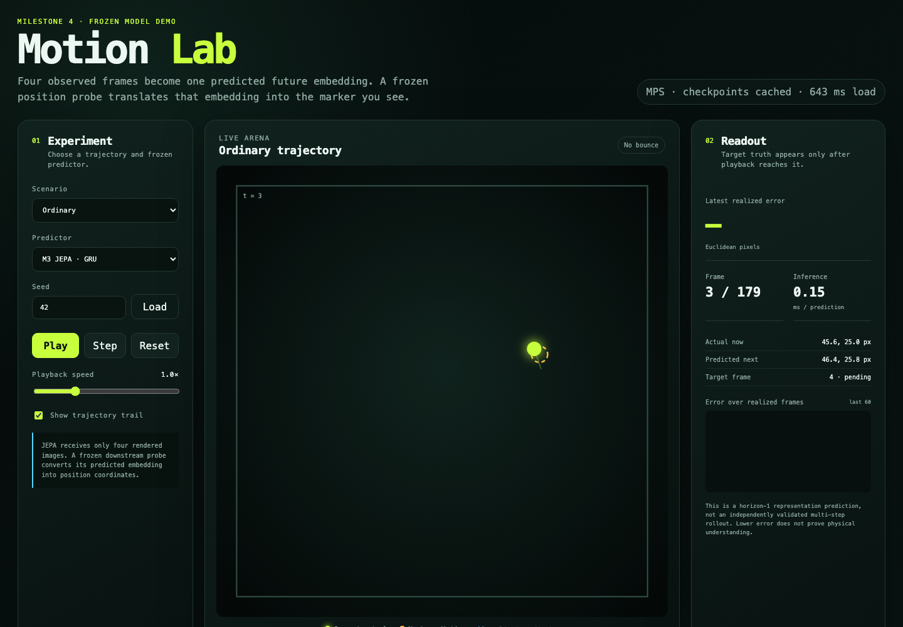
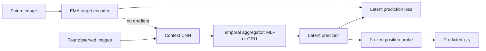

# Mini-JEPA

Mini-JEPA is a compact, reproducible research project that asks a focused question: can a
joint-embedding predictive architecture learn useful motion representations from images of a
bouncing ball? The system observes four 64×64 grayscale frames, predicts the next frame's latent
representation, and uses a separately trained linear probe to make the learned motion explicit.

The repository spans the complete experiment: deterministic simulation, self-supervised training,
frozen-representation evaluation, controlled model comparisons, and a local interactive demo. It
is intentionally small enough to inspect end to end and makes no claim that success on this toy
domain establishes general physical understanding.



## Results at a glance

Position RMSE is measured in pixels; lower is better. JEPA models receive only rendered images.
The analytic baselines receive measured positions, and the supervised CNN receives position labels.

| Method | In-distribution test | OOD test |
|---|---:|---:|
| M1 JEPA + frozen linear probe | 2.835 | 5.391 |
| Best M3 GRU JEPA, seed 502 + probe | **2.694** | **3.578** |
| M3 GRU family, 3-seed mean ± SD | 2.894 ± 0.217 | 3.884 ± 0.292 |
| Supervised CNN | 0.650 | 1.247 |
| Wall-aware analytic physics | 0.111 | 0.312 |
| Random frozen encoder + probe | 11.394 | — |

The selected GRU improves the best single run and substantially improves OOD performance, but its
three-seed mean does not beat the historical M1 model in-distribution. Multiple-bounce sequences
remain difficult (14.241 px for M1, 7.745 px for the selected M3 run). These comparisons are not
supervision-equivalent; their purpose is to locate the learned representation among useful
reference points.

## Architecture



The target encoder is an exponential-moving-average copy of the context encoder. Training matches
predicted and target embeddings; it does not reconstruct pixels and never uses simulator position
or velocity as a self-supervised target. Position labels are introduced only during downstream
probe evaluation.

## Quick start

Requirements: Python 3.12+, [`uv`](https://docs.astral.sh/uv/), and a CPU or Apple MPS device.

```bash
uv sync --locked
uv run pytest
uv run ruff check .
```

Generate and inspect a small deterministic dataset:

```bash
uv run mini-jepa generate --output data/sample --train 16 --validation 4 --test 4 \
  --frames 32 --observed 4 --horizon 1 --seed 7
uv run mini-jepa inspect data/sample/train.npz --trajectory 0 --output artifacts/sample
```

Complete trajectories are assigned to exactly one split. Each compressed NPZ retains frames,
positions, velocities, collision counts, and unique trajectory IDs; the model-facing dataset
returns rendered observations and targets without exposing physical state.

## Interactive demo

The demo requires the historical M1 model/probe and selected M3 seed-502 model/probe under their
documented artifact paths.

```bash
uv run mini-jepa-demo --host 127.0.0.1 --port 8877 --device auto
```

Open [http://127.0.0.1:8877](http://127.0.0.1:8877). It offers deterministic ordinary,
near-wall, high-speed, and multiple-bounce scenarios; playback controls; actual/predicted overlays;
error history; and comparisons among M1 JEPA, M3 JEPA, and a constant-velocity baseline. Predictions
are horizon-1 only: four frames form the context, and error appears after the target frame is shown.

## Reproduce the research pipeline

```bash
# M1: self-supervised training
uv run mini-jepa train --data data/m1 --output artifacts/m1 --epochs 5 \
  --batch-size 64 --embedding-dim 64 --hidden-dim 128 --device auto

# M2: frozen representation evaluation
uv run mini-jepa evaluate --checkpoint artifacts/m1/best.pt --data data/m1 \
  --ood-test data/m2-ood/test.npz --output artifacts/m2

# M3: controlled architecture/objective/horizon comparisons
uv run mini-jepa m3-experiments --data data/m1 \
  --m1-checkpoint artifacts/m1/best.pt --m2-artifacts artifacts/m2 \
  --ood-test data/m2-ood/test.npz --diagnostic data/m3-diagnostic/test.npz \
  --output artifacts/m3 --device auto
```

Training is stochastic and Apple MPS may not be bitwise deterministic across environments. Seeds,
split construction, commands, checkpoint provenance, and recorded hashes are documented so results
can be audited. The exact historical checkpoints are intentionally gitignored and must be obtained
separately for exact evaluation or the demo.

## Research website

A static Next.js site lives in `website/`. It presents the architecture, audited metrics, and a
browser playback demo that uses precomputed predictions from the historical checkpoints—no model
runs in the browser.

```bash
uv run python scripts/export_website_data.py --device auto --frames 120
cd website && npm ci && npm run dev
```

See [docs/website/implementation.md](docs/website/implementation.md) for GitHub Pages configuration.
Do not commit, push, or deploy without an explicit publication decision.

## Repository map

```text
src/mini_jepa/       simulation, data, models, training, evaluation, and demo
tests/               physics-through-release automated checks
website/             static research site (Next.js export)
scripts/             website data export helpers
docs/milestones/     milestone implementation and acceptance records
docs/research-overview.md
docs/portfolio-summary.md
docs/artifact-provenance.md
data/                generated datasets (gitignored)
artifacts/           checkpoints, results, and plots (gitignored)
```

## License and citation

This project is released under the [MIT License](LICENSE). Citation metadata is in
[`CITATION.cff`](CITATION.cff). See the [model card](docs/model-card.md) for architecture,
intended use, evaluation, and limitations.

## Documentation

- [Research overview](docs/research-overview.md)
- [Portfolio summary](docs/portfolio-summary.md)
- [Artifact provenance and hashes](docs/artifact-provenance.md)
- [Model card](docs/model-card.md)
- [Website implementation](docs/website/implementation.md)
- [GitHub repository metadata](docs/github-repository-metadata.md)
- [M0: simulation and dataset](docs/milestones/m0.md)
- [M1: JEPA implementation and training](docs/milestones/m1.md)
- [M2: representation evaluation](docs/milestones/m2.md)
- [M3: controlled improvements](docs/milestones/m3.md)
- [M4: interactive demo](docs/milestones/m4.md)
- [M5: final release audit](docs/milestones/m5.md)

## Scope and limitations

- The world contains one ball, axis-aligned walls, constant velocity, and elastic collisions.
- The probe measures decodability, not whether the representation encodes a complete physics model.
- The supervised and analytic baselines use stronger information than JEPA and are reference points,
  not matched competitors.
- The interface visualizes independent horizon-1 predictions, not validated autoregressive rollout.
- Exact checkpoint reproduction depends on local artifacts; public distribution needs a license,
  hosted release assets, model card, and citation metadata.

Mini-JEPA was developed and measured on an Apple Silicon Mac mini with 16 GB unified memory and
Python 3.12. CPU operation is supported; MPS is optional.
